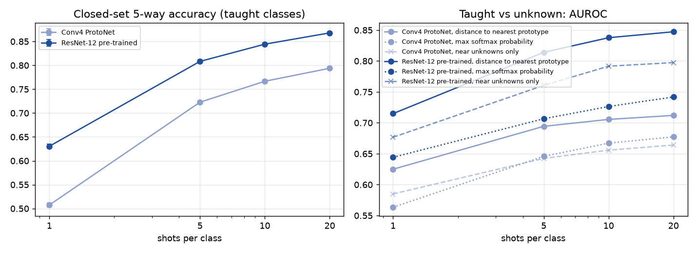
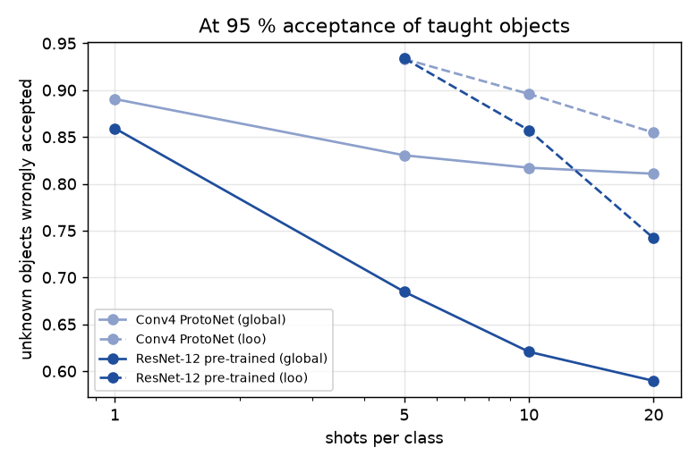
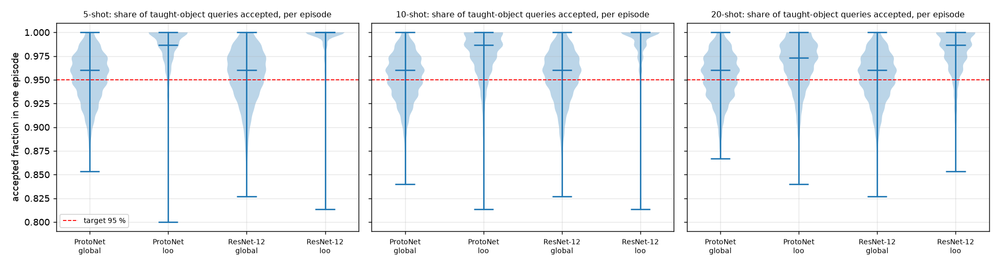

# Can a few-shot classifier say "I don't know"?

[](https://github.com/HessamKaveh/few-shot-open-set/actions/workflows/ci.yml)   [](LICENSE)

### Open-set few-shot recognition: what happens when a robot taught 5 objects meets a 6th

Few-shot learning is usually evaluated as a **closed** problem: teach N new classes with K images each, then test only
on images of those N classes. A robot taught five new objects by a user will also see objects it was **never taught**,
and in that case it should say "I don't know" rather than pick one of the five.

This project measures how well that works. It uses two standard few-shot embeddings, prototype classification and a
conformal acceptance threshold, and evaluates them on 2,000 open-set episodes from CIFAR-100 classes never seen
during training.



---

## Key findings

Each test episode teaches 5 novel classes with K images each, then queries 75 images of the taught classes and
75 images of 5 other novel classes that were **not taught**. Each number is a mean over 2,000 episodes, and all ±
values are 95 % CIs below 0.01.

| # | Question | Finding |
|---|----------|---------|
| 1 | **How well are taught and untaught objects separated?** | Poorly. The best model (ResNet-12, 20 shots) reaches **AUROC 0.85**. Conv4 ProtoNet stays at **0.62 to 0.71**. For comparison, closed-set 5-way accuracy is 87 % and 79 %. |
| 2 | **If the robot must accept 95 % of taught objects, how many unknown objects slip through?** | Most of them: **59 %** at best (ResNet-12, 20 shots), 69 % at 5 shots and **81 to 89 %** for ProtoNet. In practice the robot almost never says "I don't know". |
| 3 | **Do more shots help?** | For closed-set accuracy, yes: ProtoNet gains +7 points from 5 to 20 shots. For rejecting unknowns, much less: AUROC improves by only +0.02 and false accepts by 2 points. Teaching more examples does not teach the robot what it has *not* been taught. |
| 4 | **Is softmax confidence a good "I don't know" score?** | No. Max softmax probability, the most common default, is worse than plain **distance to the nearest prototype** in every setting: AUROC 0.74 vs 0.85, and false accepts of 88 % vs 59 % (ResNet-12, 20 shots). |
| 5 | **Are similar unknowns harder?** | Yes. An unknown from the same CIFAR superclass as a taught class (e.g. taught *palm tree*, unknown *pine tree*) is harder to reject. For ResNet-12 at 20 shots, AUROC is 0.80 for near unknowns vs 0.86 for far ones. |
| 6 | **Does a threshold calibrated on other classes transfer to new ones?** | Yes, surprisingly well. A threshold set on 16 held-out validation classes accepts **95.2 to 96.4 %** of taught objects on the 20 novel classes. With 5 to 20 shots only **3 to 5 %** of episodes fall below 90 %, close to the 2.4 % expected from sampling 75 queries alone. Within-episode leave-one-out thresholds, which need no extra data, are too conservative (97 to 100 % acceptance) and reject even fewer unknowns. With softmax they reject nothing. |

**Bottom line:** the acceptance side of the problem is solved, because a conformal threshold reliably keeps 95 % of
taught objects. The rejection side is not: the embeddings simply do not separate "one of my 5 objects" from "some
other object" well enough. For a robot this means few-shot recognition must be paired with a separate novelty
check, or with asking the user.

---

## 1. Setup

**Data.** CIFAR-100 (32 × 32 px, 600 images per class), split CIFAR-FS-style into **64 base / 16 validation / 20
novel classes** by a seeded permutation (`results/split.json`). The embeddings are trained on base classes only.
Thresholds and temperatures are tuned on validation classes only. Every number reported is on novel classes. The
20 novel classes are beetle, dinosaur, elephant, forest, kangaroo, lawn mower, motorcycle, orchid, palm tree, pine
tree, porcupine, rocket, shark, skyscraper, snail, snake, spider, tiger, tractor and whale. Six CIFAR superclasses
contain two or three of them (e.g. palm/pine tree, snail/spider, lawn mower/rocket/tractor), which gives the "near"
unknowns.

**Open-set episode.** 10 novel classes are drawn at random. 5 are *taught* (K support images each, plus 15 queries
each) and 5 are *unknown* (15 queries each). The robot has to classify the taught queries and reject the unknown
ones. K ∈ {1, 5, 10, 20}, with 2,000 episodes per K.

**Embeddings.**

| model | training on base classes | closed-set 5-way accuracy (1 / 5 / 10 / 20 shots) |
|---|---|---|
| Conv4 ProtoNet (Snell et al., 2017) | episodic, 20-way 5-shot, 30,000 episodes, Adam | 50.7 / 72.3 / 76.7 / 79.4 % |
| ResNet-12 pre-trained (Tian et al., 2020) | plain 64-way classification, 60 epochs; SimpleShot CL2N features | 63.0 / 80.8 / 84.4 / 86.8 % |

Both classify a query by the nearest class prototype (mean support embedding). The 5-shot ProtoNet number is in line
with published CIFAR-FS results (72.0 %). At 1 shot it is lower, because the model was trained with 5-shot episodes only. The ResNet-12 is a few points below published RFS numbers (short training, no
distillation, different split).

**"I don't know" scores.** A query's score is high if it looks like a taught class:

* **distance**: negative squared distance to the nearest prototype,
* **MSP**: max softmax probability over the 5 prototypes, with a temperature fitted on validation episodes,
* **relative distance**: distance divided by the spread of the support set in that episode.

**Acceptance threshold.** Accept a query if its score ≥ t. The threshold is chosen conformally, as the
⌊(n+1)·α⌋-th smallest score of n calibration scores with α = 0.05, so that ≥ 95 % of taught objects are accepted:

* **global**: calibration scores pooled from 1,000 episodes over the 16 *validation* classes,
* **leave-one-out (LOO)**: inside each test episode, each support image is scored against its own class prototype
  computed without it. This needs no extra data, only K ≥ 2.

## 2. Results

### 2.1 Separating taught from unknown objects (AUROC, per episode)

| model | score | 1 shot | 5 shots | 10 shots | 20 shots | 20 shots, near / far unknowns |
|---|---|---|---|---|---|---|
| ProtoNet | distance | 0.625 | 0.694 | 0.706 | 0.712 | 0.664 / 0.722 |
| ProtoNet | MSP | 0.563 | 0.646 | 0.667 | 0.677 | 0.673 / 0.678 |
| ResNet-12 | distance | 0.715 | 0.814 | 0.838 | **0.847** | 0.797 / 0.856 |
| ResNet-12 | MSP | 0.644 | 0.707 | 0.726 | 0.742 | 0.726 / 0.745 |

Relative distance gives exactly the same AUROC as distance, because dividing by a per-episode constant does not
change the ranking within an episode.

### 2.2 At 95 % acceptance of taught objects: how many unknowns get in?



| model | threshold | score | taught accepted | **unknown accepted** | episodes < 90 % accepted |
|---|---|---|---|---|---|
| ProtoNet, 5 shots | global | distance | 95.3 % | 83.0 % | 3.3 % |
| ProtoNet, 20 shots | global | distance | 95.3 % | 81.1 % | 3.1 % |
| ResNet-12, 5 shots | global | distance | 95.4 % | 68.5 % | 4.9 % |
| ResNet-12, 20 shots | global | distance | 95.2 % | **59.0 %** | 3.6 % |
| ResNet-12, 20 shots | global | MSP | 97.1 % | 88.1 % | 2.2 % |
| ResNet-12, 20 shots | global | relative distance | 93.4 % | 54.8 % | **22.1 %** |
| ResNet-12, 20 shots | LOO | distance | 97.8 % | 74.2 % | 1.0 % |
| ResNet-12, 20 shots | LOO | MSP | 99.9 % | 99.5 % | 0.0 % |

Relative distance rejects slightly more unknowns, but it breaks the acceptance guarantee: the support spread is a
noisy per-episode estimate, and 22 % of episodes fall below 90 %.

### 2.3 Does the acceptance guarantee hold per episode?



A conformal threshold guarantees 95 % acceptance *on average*. A user, however, experiences single episodes. With
75 taught queries, binomial sampling alone puts 2.4 % of episodes below 90 % even with a perfect threshold. The
global distance threshold gives 3 to 5 % at 5 to 20 shots (9 % for ProtoNet at 1 shot), so moving from validation to novel classes adds very little
episode-to-episode variation. The LOO threshold is over-conservative: a support image scored against a prototype
built from K−1 images is further away than a query scored against all K, so the threshold drops and almost
everything is accepted.

## Limitations

* CIFAR-100 at 32 × 32 px is far from a robot camera. The *ranking* of methods is the useful output, not the
  absolute numbers.
* Only prototype-based classifiers were tested. Methods trained explicitly for open-set few-shot recognition (e.g.
  PEELER, SnaTCHer) or using a background/"other" class might do better. They also need unknown-like data during
  training.
* Unknowns come from the same 20 novel classes. Unknowns from a completely different domain would likely be easier
  to reject (the "far" column hints at this).
* One training run per embedding. The CIs cover episode sampling, not training randomness.

## Reproduce

```bash
pip install -r requirements.txt
# CIFAR-100 as npz (X, fine, coarse, fine_names, coarse_names) in $CIFAR_DIR, see src/data.py
python src/train.py --method protonet --episodes 30000   # ~45 min on an RTX 500 Ada (4 GB)
python src/train.py --method pretrain --epochs 60        # ~30 min
python src/evaluate.py                                   # 2,000 episodes x 4 shot settings -> results/
```

```
src/data.py      CIFAR-100 loading, seeded 64/16/20 class split, superclass map
src/model.py     Conv4 and ResNet-12 embeddings
src/train.py     episodic ProtoNet training and plain 64-way pre-training
src/evaluate.py  open-set episodes, scores, global and LOO conformal thresholds, figures
```

The earlier version of this repository (Prototypical Networks on Omniglot) is still in the git history.

## References

* Snell, Swersky, Zemel. *Prototypical Networks for Few-shot Learning.* NeurIPS 2017.
* Tian, Wang, Krishnan, Tenenbaum, Isola. *Rethinking Few-Shot Image Classification: a Good Embedding Is All You Need?* ECCV 2020.
* Wang, Chao, Weinberger, van der Maaten. *SimpleShot: Revisiting Nearest-Neighbor Classification for Few-Shot Learning.* 2019.
* Bertinetto, Henriques, Torr, Vedaldi. *Meta-learning with differentiable closed-form solvers* (CIFAR-FS). ICLR 2019.
* Liu et al. *Few-Shot Open-Set Recognition using Meta-Learning* (PEELER). CVPR 2020.
* Jeong et al. *Few-shot Open-set Recognition by Transformation Consistency* (SnaTCHer). CVPR 2021.
* Vovk, Gammerman, Shafer. *Algorithmic Learning in a Random World.* 2005.

## Citation

If you use this code, please cite it (metadata in [`CITATION.cff`](CITATION.cff)):

```bibtex
@software{kaveh2026_few_shot_open_set,
  author  = {Kaveh, Hessam},
  title   = {Can a few-shot classifier say "I don't know"?},
  year    = {2026},
  version = {1.0.0},
  url     = {https://github.com/HessamKaveh/few-shot-open-set},
  license = {MIT}
}
```

---

**Author:** Hessam Kaveh, Research Fellow, Italian Institute of Technology (IIT)

License: MIT
